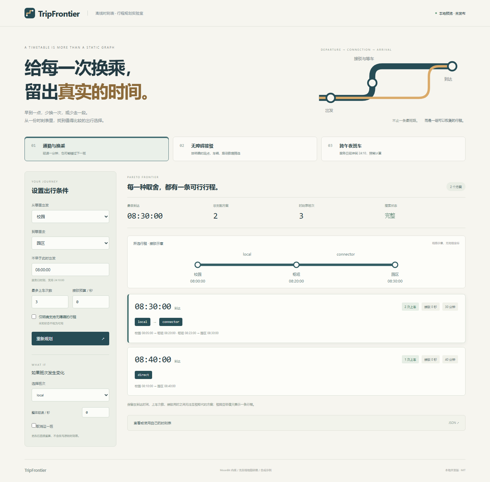

# TripFrontier

**按发车时刻和换乘条件，找到值得比较的完整行程。**

TripFrontier 是独立的 MoonBit 离线乘客行程规划库。给定一个服务日的班次、站点换乘时间、显式步行接驳和出行约束，输出在 **到达时间、上车次数、接驳用时** 上互不支配的完整行程。取消或延误班次后可从源时刻表重新计算。

本地开发版本：**未建立远程仓库、未推送、未发布、未报名**。最终参赛 GitHub 账号尚未指定，模块临时命名为 `local/tripfrontier`，不是 Mooncakes 安装地址；本地提交使用明确的开发占位作者身份。代码使用 AI 辅助开发，不能替代参赛者的理解与独立申报。



[三个完整场景](docs/SCENARIOS.md) · [模型语义](docs/SEMANTICS.md) · [JSON/API](docs/FORMAT.md) · [GTFS 子集](docs/GTFS_SUBSET.md) · [同类调查](docs/RESEARCH.md) · [规则核对](docs/RULES_2026-10-31.md) · [实际验证](docs/VALIDATION.md)

## 先运行，再评估

固定验证环境：Windows、MoonBit compiler **0.10.17+093cb8f9c** / moon 0.1.20261021，Node 22+、Python 3.12+。MoonBit 安装方式见[官方工具链文档](https://docs.moonbitlang.com/en/latest/toolchain/)。没有第三方 npm 或 Python 运行时依赖。

```text
moon run cmd/demo
node scripts/build.mjs
node bin/tripfrontier.mjs examples/commute.json
node bin/tripfrontier.mjs examples/accessible.json
node bin/tripfrontier.mjs examples/overnight.json
node scripts/serve.mjs
```

打开 `http://127.0.0.1:4186`。网页只在本地计算，不用地图密钥、外部路线 API 或在线服务。修改时间、上车次数、接驳预算、无障碍条件、班次取消/延误，可查看重新计算的结果和具体乘车段。

发布前的本地归档带预编译 dist/web 引擎，可用 Node 直接运行演示；更改 MoonBit 后应重新执行 build。源码目录不跟踪生成引擎，不能把网页当作不经构建就可打开的静态源码。

## 为什么需要时刻表规划

从校园到园区：08:05 的 local 08:20 到枢纽，换乘缓冲 120 秒；下一班 connector 08:23 开、08:30 到园区。另有 08:10 的直达班次 08:40 到。

原始前沿保留“08:30 到、2次上车”和“08:40 到、1次上车”。local 延误 60 秒仍恰好能换；延误 61 秒则赶不上，结果只剩直达。只按地理距离或固定边权做静态最短路，不能直接表示这件事。

本项目是给出这些行程的计算内核，不是时刻表检查器、现有服务代理或某个包的审计附属品。更全面的成熟系统已经存在；独立生态价值与差异如实披露在 RESEARCH.md，不宣称发明算法或世界唯一。

## 已实现的核心能力

- 按有序班次停站搜索，可等待、可超车，保留相同站点/上车数下不同到达时间与接驳消耗的非支配标签。
- 区分同车经停与重新上车；应用 pickup/dropoff 约束和站点最短换乘时间。
- 有向、多段接驳，累计预算；严格使用已明确的站点、车辆、路径无障碍标记。
- 最多八次上车、显式最晚到达时间、服务日超过 24 点的时刻。
- 返回完整 ride/walk 段、起止时刻和停站索引；独立接口可核对见证是否符合原始事实。
- 取消/整体延误班次、关闭接驳链接，从独立快照重算，不修改输入。
- 严格 JSON、MoonBit typed API、实际 CLI、离线网页；Python 导入静态 GTFS 的已说明子集。
- 达到搜索额度时明确失败，不将部分结果标成完整前沿。

## 作为库嵌入

源码包名暂为 `local/tripfrontier`。使用公开 API 的可执行示例在 [API.mbt.md](API.mbt.md)，生成签名在 [pkg.generated.mbti](pkg.generated.mbti)。`cmd/demo` 是从单独消费包导入公开接口的真实用法。

| 接口 | 作用 |
| --- | --- |
| validate / validate_query | 验证时刻表引用、时序、数据与搜索边界 |
| plan | 计算本模型内完整的三目标非支配目标值组合，每组一个行程见证 |
| verify_journey | 对原时刻表重放单条行程的可行性；不证明前沿最优性 |
| scenario | 应用班次绝对延误/取消和接驳关闭，返回不改写输入的快照 |
| decode_request / plan_json | 严格版本化文本边界与完整 JSON 结果 |

不是动态链接其他语言路由算法；搜索、支配关系、见证与核验在 MoonBit 中实现。Python 负责 CSV/服务日适配，Node 负责文件 IO 和启动，浏览器负责展示。

## GTFS 与三个场景

```text
python scripts/import_gtfs.py examples/gtfs --date 2026-10-31 --out artifacts/day.json
```

显式选择日期，支持常规周历、日期增删、明确到发时刻、24 点后时刻和已说明的 transfer 子集。频率班次、贯通、按需接客、插值、pathways 和特殊换乘等不支持语义明确拒绝。不同站点 type=2 transfer 的保守接驳映射并不等价于纯物理步行或完整 GTFS 路由。完整边界见 [GTFS_SUBSET.md](docs/GTFS_SUBSET.md)。

三个可运行用例：通勤与错失换乘、明确无障碍接驳、跨午夜及日期例外。具体输入、操作、预期输出和断言见 [SCENARIOS.md](docs/SCENARIOS.md)。数据均为合成，尚未宣称真实运营商兼容或采用。

## 验证与性能

```text
python scripts/verify.py
# 安装 Python Playwright/Chromium 后，可同时检查实际浏览器：
python scripts/verify.py --browser
```

验证记录写入 `artifacts/validation.json`，包括每条真实命令、返回码、stdout/stderr。`--native` 需要本机 C 工具链，Windows 还需要 MSVC/Windows SDK；本机当前不具备，不能声称 native 运行已通过。

当前验证项：24 个 MoonBit 测试（含可执行公开 API 文档）、7 个 Node CLI/桥接集成测试、7 个 Python GTFS 测试；240 组小网络对照独立穷举 oracle；Chromium 检查延误边界、无障碍、午夜、报告下载、注入文本和 390px 布局。

`.github/workflows/ci.yml` 配置三操作系统/四目标检查、测试与构建，以及 CLI、GTFS、oracle、Linux 浏览器检查。**因不推送，尚未运行远程 CI。**

`node scripts/benchmark.mjs` 可复现合成基准。当前 40站、192班次、1128停站、39接驳的一次查询，Windows / Node 24.22.1 / i7-14650HX，7 个样本中位 4.0916ms，包含 JSON 解析、校验、索引、求解、见证、序列化与结果解析。不外推为全国规模、真实 feed 吞吐或优于成熟算法的结论。

## 范围与提交状态

容量：512站、2048班次、20000停站、4096接驳；最多100000历史标签、2000000候选操作。受资源限制的同步离线服务日内核；不做道路地理推断、票价、完整 GTFS/GTFS-RT、多服务日合并、车辆贯通、arrive-by 或生产安全认证。未知数据不被包装为“已支持”。

MIT；标准库许可与 NOTICE 保留，见 [THIRD_PARTY_NOTICES.md](THIRD_PARTY_NOTICES.md)。独立新目录、根历史和业务实现，明确披露与旧项目无业务复用。最终实际 GitHub 账号待指定。

本地技术准备不等于完成官方验收：尚需真实账号/命名、公开仓库、远程 CI、Mooncakes 发布、本人独立写申报书和完成报名。十月规则核对、来源、状态与疑点在 [RULES_2026-10-31.md](docs/RULES_2026-10-31.md)；独立写作仅提供 [事实清单](docs/FACTS_FOR_AUTHOR.md) 和 [空白提纲](docs/APPLICATION_OUTLINE.md)。
